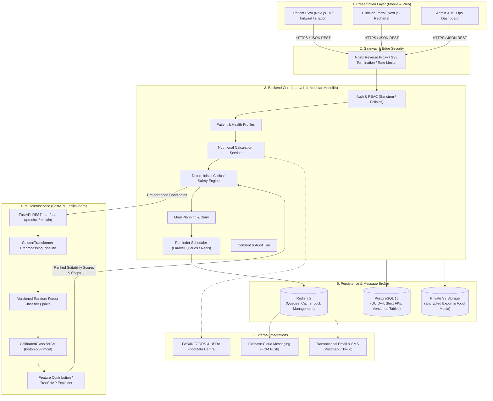
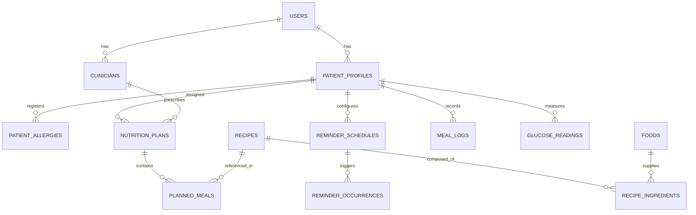

# NutriCare AI — Complete Software Development Blueprint
**Diabetic Dietary Recommendation & Reminder System**  
*Full-Stack Architecture · Random Forest ML · Web & Mobile-Ready*

---

## Executive Summary & System Scope

**NutriCare AI** is an intelligent, evidence-based dietary management platform engineered for people living with diabetes (initial scope: adults with Type 2 Diabetes Mellitus, T2DM). The system provides personalized, culturally tailored meal suggestions, rigorous nutritional accounting, proactive meal scheduling, glucose correlation tracking, and scheduled reminders.

### Core Architectural Principle: The Clinical Safety Wall
> [!IMPORTANT]
> The Machine Learning (Random Forest) classifier acts strictly as a **candidate suitability evaluator and ranking enhancer**. It is **physically decoupled from and subordinate to** the deterministic **Safety Engine**. A meal flagged by the Safety Engine (e.g., allergen collision, sodium limit violation, severe renal phosphorus/potassium contraindication, or clinician lock) is **instantly rejected**, regardless of the ML confidence score.

---

## 1. Complete System Architecture



### 1.1 Recommendation Pipeline Lifecycle (Step-by-Step)

```
[Patient / Schedule Request]
          │
          ▼
1. Fetch Patient Clinical Baseline (Age, T2D stage, HbA1c target, Daily carb limit, Allergens, Comorbidities)
          │
          ▼
2. Fetch Candidate Recipes from Verified Catalog (FAO/INFOODS + USDA calibrated)
          │
          ▼
3. Deterministic Safety Filter (Pass 1)
   ├── Allergen check (Strict exclusion: Peanuts, Shellfish, Gluten, etc.)
   ├── Clinician Hard Exclusions (e.g. strict sodium < 1500mg for Stage 3 CKD)
   └── Daily Macro Headroom check (Meal Carbs <= Remaining Daily Allowance)
          │
   [Failed] ──> Drop Candidate completely (Logged with reason code)
   [Passed] ──> Qualified Candidates (Array of Candidate Meals)
          │
          ▼
4. Dispatch to Python ML Service (/api/v1/ml/predict-batch)
   ├── Preprocess with fitted ColumnTransformer (Imputation + One-Hot)
   ├── Random Forest Inference (300 Trees)
   ├── Calibrated Probability Output [P(eligible), P(review_required), P(not_recommended)]
   └── Local TreeSHAP Feature Attribution (Top 3 driving factors)
          │
          ▼
5. Post-Inference Clinical Rules & Hybrid Ranker (Pass 2)
   ├── Filter out any candidate with P(not_recommended) > 0.35
   ├── Weight by Patient Preferences (Liked dishes, Prep time, Cultural staples)
   ├── Variety Decay Penalty (Penalize recipes eaten in the past 72 hours)
   └── Composite Score = 0.50 * ML_Score + 0.30 * Preference_Score + 0.20 * Variety_Score
          │
          ▼
6. Render Ranked Recommendations with Clinician Notes & Plain-Language Explanation
```

---

## 2. Technology Stack & Project Structure

| Layer | Selected Tech | Rationale & Deployment Profile |
| :--- | :--- | :--- |
| **Frontend Framework** | **Next.js 14+ (App Router), TypeScript** | Server Components for fast SEO landing, Client Components for interactive PWA, responsive across iOS/Android/Desktop |
| **UI System & Styling** | **Tailwind CSS, shadcn/ui, Radix UI** | Accessible (WCAG 2.2 AA compliant), headless primitives, zero runtime CSS overhead |
| **State Management** | **Zustand & TanStack Query (React Query)** | Optimistic UI updates for diary entries and offline cache handling |
| **Icons & Visuals** | **Lucide Icons & Recharts** | High-performance SVG charts for glycemic metrics, macronutrient breakdown, and compliance trends |
| **Backend Monolith** | **Laravel 11 (PHP 8.3)** | Enterprise-grade ORM (Eloquent), strict routing, robust Policy authorization, native Queue management |
| **Relational Database** | **PostgreSQL 16** | Strict transactional integrity, native UUIDv4, JSONB for recipe nutrient variance, GIN indexing |
| **Cache & Message Broker** | **Redis 7.2** | Sub-millisecond queue dispatch, atomic rate limiting, distributed lock for reminder firings |
| **ML Inference Service** | **FastAPI, Python 3.11, scikit-learn 1.4+** | Asynchronous high-throughput REST inference, Uvicorn worker pools, isolated dependencies |
| **Push Notifications** | **Firebase Cloud Messaging (FCM)** | PWA Web Push + native mobile push background delivery |
| **Containerization** | **Docker & Docker Compose** | Reproducible multi-container topology (web, api, ml-service, redis, postgres) |

### 2.1 Standardized Directory Structure

```
nutricare-ai/
├── frontend/                     # Next.js 14 Frontend Application
│   ├── src/
│   │   ├── app/
│   │   │   ├── (public)/         # Landing, FAQs, Clinician Directory, Contact
│   │   │   ├── (auth)/           # Login, Register, Forgot Password, Verify
│   │   │   ├── (onboarding)/     # 6-Step Patient Clinical Intake Wizard
│   │   │   ├── (patient)/        # Dashboard, Planner, Explorer, Diary, Glucose, Reminders
│   │   │   ├── (clinician)/      # Patient Directory, Plan Builder, Review Queue
│   │   │   └── (admin)/          # ML Ops, Dataset Manager, Safety Rules, Audits
│   │   ├── components/
│   │   │   ├── ui/               # shadcn primitives (Button, Dialog, Card, Badge, etc.)
│   │   │   ├── layout/           # PatientNav, MobileBottomTabs, ClinicianSidebar
│   │   │   ├── forms/            # FoodEntryForm, GlucoseEntryModal, OnboardingStepForms
│   │   │   ├── meals/            # MealCard, NutrientBadge, PortionSelector, AllergenPill
│   │   │   ├── charts/           # GlucoseTrendChart, MacroDonutChart, WeeklyAdherenceBar
│   │   │   └── reminders/        # ReminderItem, SnoozeActionSheet, TimePicker
│   │   ├── lib/                  # axios client, utils, validators, date helpers
│   │   ├── hooks/                # useRecommendations, useReminders, useGlucose
│   │   └── types/                # TypeScript DTOs and API contracts
│   ├── tailwind.config.ts
│   └── package.json
│
├── backend/                      # Laravel 11 Modular Monolith
│   ├── app/
│   │   ├── Http/
│   │   │   ├── Controllers/Api/v1/ # Auth, Patient, Nutrition, Meal, Glucose, Reminder
│   │   │   ├── Middleware/       # RoleMiddleware, AuditLogger, ConsentEnforcer
│   │   │   └── Requests/Api/v1/  # Validated Form Requests
│   │   ├── Models/               # User, PatientProfile, Recipe, MealPlan, GlucoseReading
│   │   ├── Policies/             # PatientPolicy, NutritionPlanPolicy, RecipePolicy
│   │   ├── Services/
│   │   │   ├── Nutrition/        # YieldCalculator, MacroAggregator, RegionalFoodAdapter
│   │   │   ├── Recommendations/  # CandidateGenerator, MLServiceClient, HybridRanker
│   │   │   ├── Safety/           # DeterministicSafetyEngine, AllergenFilter, RenalRule
│   │   │   ├── Reminders/        # CronScheduler, NotificationDispatcher, SnoozeManager
│   │   │   └── Clinical/         # PlanApprovalService, ClinicalReviewQueue
│   │   ├── Jobs/                 # DispatchReminderJob, LogPredictionMetricJob
│   │   └── Notifications/        # MealReminderNotification, GlucoseSpikeAlert
│   ├── database/
│   │   ├── migrations/           # PostgreSQL Schema Migrations (UUID primary keys)
│   │   └── seeders/              # FAO/INFOODS & USDA Seeders, Clinician Demo Seeders
│   └── routes/api.php            # Versioned API routes (/api/v1/...)
│
├── ml-service/                   # Python FastAPI Machine Learning Microservice
│   ├── app/
│   │   ├── main.py               # FastAPI App definition & Lifespan Hooks
│   │   ├── config.py             # Model artifact paths, environment configs
│   │   ├── schemas.py            # Pydantic v2 Input/Output validation contracts
│   │   ├── preprocessing.py      # ColumnTransformer pipeline loaders
│   │   ├── inference.py          # Calibrated RandomForest prediction & scoring
│   │   └── explainer.py          # SHAP-based feature importance translator
│   ├── training/
│   │   ├── prepare_data.py       # Clinical rubric dataset formatter & GroupSplitter
│   │   ├── train.py              # Hyperparameter tuning (GridSearchCV) & fitting
│   │   ├── evaluate.py           # Confusion matrix, ROC-AUC, Brier score, Fairlearn audit
│   │   └── calibrate.py          # CalibratedClassifierCV Isotonic fitting
│   ├── models/                   # Versioned artifacts (e.g. meal_suitability_v1.0.joblib)
│   └── requirements.txt          # fastapi, uvicorn, scikit-learn, joblib, pydantic, shap
│
├── infrastructure/
│   ├── docker/
│   │   ├── frontend.Dockerfile
│   │   ├── backend.Dockerfile
│   │   └── ml-service.Dockerfile
│   └── nginx/nginx.conf          # Reverse proxy routing, SSL, compression, rate limits
└── docker-compose.yml            # Multi-service local & production orchestrator
```

---

## 3. UI/UX Design System & Mobile-First Standards

### 3.1 Design Tokens

```css
:root {
  /* Brand Primary & Secondary */
  --color-primary: #16835D;       /* Primary Green - Trust, Nutrition, Success */
  --color-primary-dark: #123F35;  /* Deep Evergreen - Headers, Emphasis */
  --color-primary-mint: #DDF3E8;  /* Mint Tint - Active pill, Highlights */
  --color-primary-sage: #EDF7F1;  /* Soft Sage - Card backgrounds */
  --color-canvas: #FAFBF8;        /* Warm Canvas - Application Background */
  --color-charcoal: #20332E;      /* Charcoal - Main Typography */

  /* Functional Clinical Palette */
  --color-info: #245EAD;          /* Information / Clinician notes */
  --color-warning: #995600;       /* Caution / Carb warning / Borderline glucose */
  --color-critical: #B42318;      /* Danger / Allergen conflict / Hypoglycemia alert */

  /* Typography */
  --font-heading: 'Manrope', -apple-system, sans-serif;
  --font-body: 'Inter', -apple-system, sans-serif;

  /* Elevation & Border Radius */
  --radius-card: 18px;
  --radius-button: 12px;
  --radius-pill: 9999px;
  --min-touch-target: 44px;
}
```

### 3.2 Mobile-First Navigation Model
- **Bottom Navigation Bar (Patient Mobile):**
  1. `Home` (`/dashboard`) — Today's plan, immediate next meal, countdown to reminder, quick glucose log button.
  2. `Explore` (`/explore`) — Search catalog, filter by meal type (Breakfast, Lunch, Dinner, Snack), filter by local staples (e.g. Nigerian swallows, beans, soups).
  3. `My Plan` (`/plan`) — 7-day horizontal calendar bar with meal slot substitution and clinician approval state.
  4. `Reminders` (`/reminders`) — Active alarms, schedule time pickers, sound toggles, snooze intervals.
  5. `Profile` (`/profile`) — Clinical parameters, allergy registry, connected dietitian, consent & data export.

- **Desktop Clinician / Admin Navigation:**
  - Fixed 260px left sidebar with persistent patient count, alert badges, and expandable patient lists.
  - Sticky top header with contextual search (`Ctrl + K`), notification tray, and active clinician credentials.

---

## 4. Comprehensive Page-by-Page UI Specifications

### 4.1 Patient Onboarding Wizard (6 Steps)
```
Step 1: Identity & Demographics  --> Name, DOB/Age, Gender, Preferred Language, Timezone
Step 2: Diabetes & Clinical Status --> T2D duration, Last recorded HbA1c, Med category (Metformin, SGLT2, Insulin)
Step 3: Allergens & Exclusions    --> Multi-select chips (Groundnuts, Crustaceans, Eggs, Dairy, Soy, Wheat) + Custom
Step 4: Dietary Habits & Culture  --> Regional preference (West African/Nigerian, Mediterranean, Low Carb), Meal frequency
Step 5: Nutrition Target Link     --> Link with assigned Clinician or select ADA Standard Balanced Baseline
Step 6: Reminder Configuration    --> Breakfast time, Lunch time, Dinner time, Notification channels, Consent agreement
```

### 4.2 Patient Dashboard (`/dashboard`)
- **Header:** Personalized greeting, current date, active streak, and status badge ("Clinician Approved Plan Active").
- **Hero Card (Next Scheduled Meal):**
  - Displays high-resolution picture of the upcoming dish (e.g., *Moi Moi with Steamed Fish and Spinach*).
  - Countdown clock (e.g., "Lunch in 42 minutes").
  - Portion: `250g` | Carbs: `28g` | Protein: `22g` | Fat: `9g` | Fiber: `8g` | Energy: `281 kcal`.
  - Actions: `[Mark as Eaten]` (records directly into Food Diary) · `[Swap Dish]` · `[Snooze Reminder 15m]`.
- **Today's Macro Progress Widget:**
  - Segmented progress bars showing consumed vs. remaining targets:
    - Net Carbs (e.g., 65g / 130g limit)
    - Dietary Fiber (e.g., 22g / 35g goal)
    - Protein & Total Calories
- **Recent Glucose Tile:**
  - Latest reading with timestamp (e.g., "118 mg/dL — 2h Post-Breakfast").
  - Quick action: `+ Log Reading`.

### 4.3 Food Explorer & Recommendation Screen (`/explore`)
- **Filter Bar:** Search input with live debouncing, Meal Type chips (`All`, `Breakfast`, `Lunch`, `Dinner`, `Snacks`), Preparation Time (`<20 mins`, `<40 mins`), and Calorie bracket.
- **Card Specifications:**
  - Title, High-res photo, Source indicator (`FAO/INFOODS Verified` or `Clinician Approved Recipe`).
  - Nutrient breakdown grid for standard serving weight.
  - **Suitability Explainer Pill:** "Matches your 35g lunch carb limit · High Fiber (7.2g)".
  - **Allergen Verification Tag:** Green checkmark: "Free from your registered allergens".
  - Actions: `View Detailed Recipe`, `Add to Weekly Plan`, `Substitute Current Meal`.

### 4.4 Clinician Review Queue & Meal Plan Builder (`/clinician/builder`)
- **Split-View Workspace:**
  - Left pane (40% width): Patient Clinical Baseline (Age, renal status, target ranges, medication protocol, past 14-day average glucose).
  - Right pane (60% width): 7-Day Interactive Meal Grid.
- **Features:**
  - Drag-and-drop recipe cards into breakfast/lunch/dinner slots.
  - Real-time summation of day's macronutrients with automatic flags if carbs exceed safety thresholds.
  - One-click "Lock & Approve Plan" button with cryptographic signature timestamp in the audit table.

---

## 5. Nutritional Science & Regional Database Architecture

### 5.1 Dual-Source Catalog Strategy
To provide realistic dietary recommendations without cultural bias, NutriCare AI integrates:
1. **FAO/INFOODS West African Food Composition Table (2019):** Calibrated for indigenous staples (Beans, Cowpeas, Yam, Cassava derivatives like Eba/Garri, Plantain, Leafy soups like Bitterleaf, Afang, Ewedu, Okra, Egusi).
2. **USDA FoodData Central:** Comprehensive foundation for global ingredients, packaged staples, and micronutrients (Potassium, Sodium, Magnesium, Glycemic Index proxies).

### 5.2 Recipe Nutrient Mathematical Formulation
A recipe $R$ composed of $n$ ingredients has its total nutrient $N_{\text{recipe}}$ computed from the edible portion weight $w_i$ of each ingredient $i$ and its concentration per 100g $N_i$:

$$N_{\text{recipe}} = \sum_{i=1}^{n} \left( \frac{w_i}{100} \times N_i \times Y_i \right)$$

Where $Y_i$ is the retention yield factor accounting for cooking method (e.g., boiling, steaming, frying).

The nutrient content per individual served portion $N_{\text{serving}}$ is determined by:

$$N_{\text{serving}} = N_{\text{recipe}} \times \left( \frac{W_{\text{serving}}}{W_{\text{final\_cooked}}} \right)$$

*Zero-tolerance missing value handling: Any candidate ingredient missing critical diabetic parameters (Carbohydrates, Fiber, or Energy) is flagged as `data_incomplete = TRUE` and prevented from automatic ML generation until verified by a dietitian.*

---

## 6. Random Forest Machine Learning Implementation

### 6.1 Clinical ML Task Formulation
- **Unit of Observation:** A tuple of `(Patient Profile Vector, Candidate Meal Vector)`.
- **Target Variable ($y$):** 3-class categorical label:
  - `0: eligible` — Conforms to clinical parameters, macro targets, and glycemic stability.
  - `1: review_required` — Close to threshold limits or novel preparation; requires dietitian sign-off.
  - `2: not_recommended` — Unfavorable macronutrient profile, high glycemic load, or clinical incompatibility.

### 6.2 Feature Vector Architecture

```
Features Input Vector (18 dimensions):
├── Demographic & Clinical:
│   ├── age (numeric: integer)
│   ├── medication_risk_category (categorical: low_metformin, moderate_sulfonylurea, high_insulin)
│   ├── approved_energy_goal (numeric: kcal/day)
│   └── approved_carb_max_per_meal (numeric: g/meal)
├── Meal Characteristics:
│   ├── meal_type (categorical: breakfast, lunch, dinner, snack)
│   ├── portion_g (numeric: serving weight in grams)
│   ├── energy_kcal (numeric: total energy)
│   ├── carbs_g (numeric: total carbohydrates)
│   ├── fiber_g (numeric: dietary fiber)
│   ├── net_carbs_g (derived: carbs_g - fiber_g)
│   ├── protein_g (numeric: protein content)
│   ├── fat_g (numeric: total lipid)
│   ├── sodium_mg (numeric: sodium)
│   ├── glycemic_load_proxy (derived: net_carbs * GI_estimate / 100)
│   └── preparation_method (categorical: boiled, steamed, baked, grilled, fried)
```

### 6.3 Machine Learning Pipeline Implementation (`ml-service/app/inference.py`)

```python
"""
NutriCare AI - Machine Learning Inference Engine
FastAPI Service with Calibrated Random Forest & TreeSHAP
"""

import os
import joblib
import numpy as np
import pandas as pd
from fastapi import FastAPI, HTTPException, status
from pydantic import BaseModel, Field
from typing import List, Dict, Any, Optional

app = FastAPI(
    title="NutriCare AI - Meal Suitability ML Service",
    version="1.0.0",
    description="Random Forest Suitability Classifier with Probabilistic Calibration"
)

MODEL_PATH = os.getenv("MODEL_PATH", "models/meal_suitability_rf.joblib")

# Global pipeline holder
model_pipeline = None

@app.on_event("startup")
def load_model():
    global model_pipeline
    if os.path.exists(MODEL_PATH):
        model_pipeline = joblib.load(MODEL_PATH)
    else:
        # Fallback for initialization / test environments
        model_pipeline = None

class CandidateMealFeatures(BaseModel):
    recipe_id: str
    meal_type: str = Field(..., example="lunch")
    portion_g: float = Field(..., gt=0, example=250.0)
    energy_kcal: float = Field(..., ge=0, example=320.0)
    carbs_g: float = Field(..., ge=0, example=28.5)
    fiber_g: float = Field(..., ge=0, example=7.2)
    protein_g: float = Field(..., ge=0, example=22.0)
    fat_g: float = Field(..., ge=0, example=9.4)
    sodium_mg: float = Field(..., ge=0, example=380.0)
    preparation_method: str = Field(..., example="steamed")

class PatientContext(BaseModel):
    patient_id: str
    age: int = Field(..., ge=18, le=120, example=52)
    medication_risk_category: str = Field(..., example="low_metformin")
    approved_energy_goal: float = Field(..., example=1800.0)
    approved_carb_max_per_meal: float = Field(..., example=45.0)

class PredictionRequest(BaseModel):
    patient: PatientContext
    candidates: List[CandidateMealFeatures]

class PredictionResult(BaseModel):
    recipe_id: str
    suitability: str
    probabilities: Dict[str, float]
    primary_factors: List[str]
    confidence_score: float

@app.post("/predict", response_model=List[PredictionResult])
async def predict_meal_suitability(payload: PredictionRequest):
    if not model_pipeline:
        raise HTTPException(
            status_code=status.HTTP_503_SERVICE_UNAVAILABLE,
            detail="Model weights not loaded or undergoing retraining."
        )

    records = []
    for cand in payload.candidates:
        net_carbs = max(0.0, cand.carbs_g - cand.fiber_g)
        records.append({
            "age": payload.patient.age,
            "medication_risk_category": payload.patient.medication_risk_category,
            "approved_energy_goal": payload.patient.approved_energy_goal,
            "approved_carb_max_per_meal": payload.patient.approved_carb_max_per_meal,
            "meal_type": cand.meal_type,
            "portion_g": cand.portion_g,
            "energy_kcal": cand.energy_kcal,
            "carbs_g": cand.carbs_g,
            "fiber_g": cand.fiber_g,
            "net_carbs_g": net_carbs,
            "protein_g": cand.protein_g,
            "fat_g": cand.fat_g,
            "sodium_mg": cand.sodium_mg,
            "preparation_method": cand.preparation_method
        })

    df_input = pd.DataFrame(records)

    try:
        raw_probs = model_pipeline.predict_proba(df_input)
        classes = model_pipeline.classes_

        results = []
        for idx, cand in enumerate(payload.candidates):
            prob_dict = {str(classes[c]): float(raw_probs[idx][c]) for c in range(len(classes))}
            pred_class = classes[np.argmax(raw_probs[idx])]

            # Extract human-interpretable rationale from features
            factors = []
            if cand.fiber_g >= 6.0:
                factors.append(f"High fiber content ({cand.fiber_g}g) promotes glycemic stability")
            if cand.carbs_g <= payload.patient.approved_carb_max_per_meal:
                factors.append(f"Carbohydrates ({cand.carbs_g}g) within prescribed limit ({payload.patient.approved_carb_max_per_meal}g)")
            if cand.preparation_method in ["steamed", "boiled", "grilled"]:
                factors.append(f"Healthy preparation method: {cand.preparation_method}")

            results.append(PredictionResult(
                recipe_id=cand.recipe_id,
                suitability=pred_class,
                probabilities=prob_dict,
                primary_factors=factors[:3],
                confidence_score=round(float(np.max(raw_probs[idx])), 4)
            ))

        return results

    except Exception as e:
        raise HTTPException(status_code=500, detail=f"Inference error: {str(e)}")
```

---

## 7. Database Architecture & PostgreSQL DDL Schema

### 7.1 Entity Relationship Diagram



### 7.2 Core PostgreSQL DDL

```sql
-- Enable cryptographic UUID extension
CREATE EXTENSION IF NOT EXISTS "uuid-ossp";

-- 1. Identity & Role Schema
CREATE TYPE user_role_enum AS ENUM ('patient', 'clinician', 'admin');

CREATE TABLE users (
    id UUID PRIMARY KEY DEFAULT uuid_generate_v4(),
    email VARCHAR(255) UNIQUE NOT NULL,
    password_hash VARCHAR(255) NOT NULL,
    role user_role_enum NOT NULL DEFAULT 'patient',
    is_active BOOLEAN NOT NULL DEFAULT TRUE,
    email_verified_at TIMESTAMPTZ,
    created_at TIMESTAMPTZ NOT NULL DEFAULT CURRENT_TIMESTAMP,
    updated_at TIMESTAMPTZ NOT NULL DEFAULT CURRENT_TIMESTAMP
);

-- 2. Patient Clinical Profile
CREATE TYPE diabetes_type_enum AS ENUM ('type_2', 'pre_diabetes', 'gestational', 'type_1_unsupported');

CREATE TABLE patient_profiles (
    id UUID PRIMARY KEY DEFAULT uuid_generate_v4(),
    user_id UUID UNIQUE NOT NULL REFERENCES users(id) ON DELETE CASCADE,
    first_name VARCHAR(100) NOT NULL,
    last_name VARCHAR(100) NOT NULL,
    date_of_birth DATE NOT NULL,
    gender VARCHAR(20) NOT NULL,
    timezone VARCHAR(50) NOT NULL DEFAULT 'Africa/Lagos',
    diabetes_type diabetes_type_enum NOT NULL DEFAULT 'type_2',
    hba1c_latest NUMERIC(4, 2),
    medication_risk VARCHAR(50) NOT NULL DEFAULT 'low_metformin',
    daily_energy_kcal_target NUMERIC(6, 2) NOT NULL DEFAULT 1800.00,
    daily_carb_g_limit NUMERIC(6, 2) NOT NULL DEFAULT 130.00,
    created_at TIMESTAMPTZ NOT NULL DEFAULT CURRENT_TIMESTAMP,
    updated_at TIMESTAMPTZ NOT NULL DEFAULT CURRENT_TIMESTAMP
);

-- 3. Patient Allergens (Strict Exclusion List)
CREATE TABLE allergens (
    id UUID PRIMARY KEY DEFAULT uuid_generate_v4(),
    name VARCHAR(100) UNIQUE NOT NULL,
    description TEXT
);

CREATE TABLE patient_allergies (
    id UUID PRIMARY KEY DEFAULT uuid_generate_v4(),
    patient_id UUID NOT NULL REFERENCES patient_profiles(id) ON DELETE CASCADE,
    allergen_id UUID NOT NULL REFERENCES allergens(id) ON DELETE RESTRICT,
    severity VARCHAR(30) DEFAULT 'severe',
    created_at TIMESTAMPTZ NOT NULL DEFAULT CURRENT_TIMESTAMP,
    UNIQUE (patient_id, allergen_id)
);

-- 4. Verified Food & Recipe Catalog
CREATE TABLE foods (
    id UUID PRIMARY KEY DEFAULT uuid_generate_v4(),
    common_name VARCHAR(200) NOT NULL,
    scientific_name VARCHAR(200),
    data_source VARCHAR(50) NOT NULL, -- 'FAO_INFOODS_2019' or 'USDA_FDC'
    external_code VARCHAR(100),
    energy_kcal_per_100g NUMERIC(6, 2) NOT NULL,
    carbs_g_per_100g NUMERIC(6, 2) NOT NULL,
    protein_g_per_100g NUMERIC(6, 2) NOT NULL,
    fat_g_per_100g NUMERIC(6, 2) NOT NULL,
    fiber_g_per_100g NUMERIC(6, 2) NOT NULL DEFAULT 0.00,
    sodium_mg_per_100g NUMERIC(7, 2) NOT NULL DEFAULT 0.00,
    is_verified BOOLEAN NOT NULL DEFAULT TRUE,
    created_at TIMESTAMPTZ NOT NULL DEFAULT CURRENT_TIMESTAMP
);

CREATE TABLE recipes (
    id UUID PRIMARY KEY DEFAULT uuid_generate_v4(),
    title VARCHAR(255) NOT NULL,
    regional_category VARCHAR(100) DEFAULT 'West African',
    preparation_method VARCHAR(50) NOT NULL DEFAULT 'boiled',
    instructions TEXT NOT NULL,
    standard_portion_g NUMERIC(6, 2) NOT NULL,
    total_yield_g NUMERIC(7, 2) NOT NULL,
    energy_kcal NUMERIC(6, 2) NOT NULL,
    carbs_g NUMERIC(6, 2) NOT NULL,
    fiber_g NUMERIC(6, 2) NOT NULL,
    protein_g NUMERIC(6, 2) NOT NULL,
    fat_g NUMERIC(6, 2) NOT NULL,
    sodium_mg NUMERIC(7, 2) NOT NULL,
    is_active BOOLEAN NOT NULL DEFAULT TRUE,
    created_at TIMESTAMPTZ NOT NULL DEFAULT CURRENT_TIMESTAMP
);

-- 5. Clinician-Approved Nutrition Plans & Planned Meals
CREATE TABLE nutrition_plans (
    id UUID PRIMARY KEY DEFAULT uuid_generate_v4(),
    patient_id UUID NOT NULL REFERENCES patient_profiles(id) ON DELETE CASCADE,
    approved_by_clinician_id UUID REFERENCES users(id),
    plan_version INT NOT NULL DEFAULT 1,
    start_date DATE NOT NULL,
    end_date DATE,
    status VARCHAR(30) NOT NULL DEFAULT 'active', -- 'draft', 'active', 'archived'
    clinical_notes TEXT,
    created_at TIMESTAMPTZ NOT NULL DEFAULT CURRENT_TIMESTAMP
);

CREATE TABLE planned_meals (
    id UUID PRIMARY KEY DEFAULT uuid_generate_v4(),
    nutrition_plan_id UUID NOT NULL REFERENCES nutrition_plans(id) ON DELETE CASCADE,
    recipe_id UUID NOT NULL REFERENCES recipes(id),
    scheduled_date DATE NOT NULL,
    meal_type VARCHAR(20) NOT NULL, -- 'breakfast', 'lunch', 'dinner', 'snack'
    portion_g NUMERIC(6, 2) NOT NULL,
    nutrient_snapshot JSONB NOT NULL, -- Preserves exact nutrients at time of planning
    is_eaten BOOLEAN NOT NULL DEFAULT FALSE,
    created_at TIMESTAMPTZ NOT NULL DEFAULT CURRENT_TIMESTAMP
);

-- 6. Glucose Diary & Clinical Escalation Tracking
CREATE TABLE glucose_readings (
    id UUID PRIMARY KEY DEFAULT uuid_generate_v4(),
    patient_id UUID NOT NULL REFERENCES patient_profiles(id) ON DELETE CASCADE,
    reading_mg_dl NUMERIC(5, 1) NOT NULL,
    reading_mmol_l NUMERIC(4, 2) GENERATED ALWAYS AS (reading_mg_dl / 18.0182) STORED,
    measurement_context VARCHAR(50) NOT NULL, -- 'fasting', 'pre_meal', 'post_meal_2h', 'bedtime'
    recorded_at TIMESTAMPTZ NOT NULL,
    is_emergency_escalation BOOLEAN NOT NULL DEFAULT FALSE,
    notes TEXT,
    created_at TIMESTAMPTZ NOT NULL DEFAULT CURRENT_TIMESTAMP
);

-- 7. Reminder Engine Tables
CREATE TABLE reminder_schedules (
    id UUID PRIMARY KEY DEFAULT uuid_generate_v4(),
    patient_id UUID NOT NULL REFERENCES patient_profiles(id) ON DELETE CASCADE,
    meal_type VARCHAR(20) NOT NULL,
    scheduled_time TIME NOT NULL,
    is_enabled BOOLEAN NOT NULL DEFAULT TRUE,
    created_at TIMESTAMPTZ NOT NULL DEFAULT CURRENT_TIMESTAMP
);

CREATE TABLE reminder_occurrences (
    id UUID PRIMARY KEY DEFAULT uuid_generate_v4(),
    schedule_id UUID NOT NULL REFERENCES reminder_schedules(id) ON DELETE CASCADE,
    target_time TIMESTAMPTZ NOT NULL,
    delivered_at TIMESTAMPTZ,
    status VARCHAR(30) NOT NULL DEFAULT 'pending', -- 'pending', 'sent', 'snoozed', 'failed'
    snooze_count INT NOT NULL DEFAULT 0,
    error_message TEXT
);
```

---

## 8. Complete REST API Specification

All endpoints are versioned under `/api/v1` and require `Authorization: Bearer <token>` (except public auth routes).

### 8.1 Authentication & Profile
- `POST /api/v1/auth/register` — Patient registration with terms & consent payload.
- `POST /api/v1/auth/login` — Returns Bearer token, user role, and profile completion state.
- `POST /api/v1/auth/logout` — Revokes current token.
- `GET /api/v1/patient/profile` — Retrieves clinical profile, targets, and allergy flags.
- `PATCH /api/v1/patient/profile` — Updates personal preferences, notification times, units.

### 8.2 Food & Recipe Catalog
- `GET /api/v1/foods` — Filter foods by `search`, `source`, `category`.
- `GET /api/v1/recipes` — List recipes with macro filters (e.g. `max_carbs=40`, `meal_type=lunch`).
- `GET /api/v1/recipes/{id}` — Full recipe details, verified ingredients, prep instructions.

### 8.3 ML Recommendation Engine
- `POST /api/v1/recommendations/generate`
  - **Body:** `{ "meal_type": "lunch", "preferred_categories": ["West African"], "max_prep_minutes": 30 }`
  - **Process:** Safety Engine Filters -> ML Service Inference -> Hybrid Ranker.
  - **Response:**
  ```json
  {
    "status": "success",
    "data": [
      {
        "recipe_id": "8b58498f-a9cb-4d3f-a6d1-419bcf82c81a",
        "title": "Steamed Moi Moi with Leafy Vegetables",
        "portion_g": 250,
        "energy_kcal": 285.0,
        "carbs_g": 27.5,
        "fiber_g": 8.1,
        "suitability": "eligible",
        "confidence": 0.94,
        "rationale": [
          "High fiber content (8.1g) slows carbohydrate absorption",
          "Carbohydrate load well within your 45g lunch limit"
        ]
      }
    ]
  }
  ```

### 8.4 Meal Planner & Food Diary
- `GET /api/v1/meal-plans/current` — Retrieves active 7-day schedule with planned meals.
- `POST /api/v1/planned-meals/{id}/substitute` — Replaces meal slot with an eligible recipe.
- `POST /api/v1/meal-logs` — Logs consumed meal (photo upload, actual portion, timestamp).
- `GET /api/v1/meal-logs` — Historical log query by date range with macronutrient sums.

### 8.5 Glucose Diary & Clinical Escalations
- `POST /api/v1/glucose-readings`
  - **Body:** `{ "reading_mg_dl": 54.0, "measurement_context": "fasting", "recorded_at": "2026-09-24T07:30:00Z" }`
  - **Response Logic:** If reading $< 70 \text{ mg/dL}$ (Hypoglycemia) or $> 300 \text{ mg/dL}$ (Hyperglycemia), returns clinical emergency protocol instructions (`escalation_alert: true`) and flags the clinician review queue.

### 8.6 Scheduled Reminders
- `GET /api/v1/reminders` — Retrieves patient's active schedules.
- `PATCH /api/v1/reminders/{id}` — Updates schedule time or enabled status.
- `POST /api/v1/reminders/{occurrence_id}/snooze` — Snoozes reminder by 15, 30, or 60 minutes.

### 8.7 Clinician Management & Approvals
- `GET /api/v1/clinician/patients` — List assigned patients with compliance and glycemic indicators.
- `GET /api/v1/clinician/review-queue` — Pending meal plans, glucose spikes, and system flags.
- `POST /api/v1/clinician/plans/{id}/approve` — Clinician cryptographically signs and locks a 7-day plan.
- `POST /api/v1/clinician/patients/{id}/targets` — Sets clinical nutrition thresholds (Carb ceiling, Sodium limit).

---

## 9. Security, Privacy & Regulatory Compliance (HIPAA / GDPR / NDPR)

1. **Data Isolation & Cryptography:**
   - All patient health metrics, glucose readings, and medication categories are stored encrypted at rest using AES-256.
   - Database connections enforce TLS 1.3.
2. **Access Control (RBAC):**
   - Clinicians can only view patients explicitly assigned to them via `patient_clinicians` link.
   - Administrators cannot browse individual patient health records without an explicit audit log reason code.
3. **Consent Versioning:**
   - Every patient must sign explicit, granular consents:
     - Health data processing consent.
     - ML model inference consent.
     - Push notification consent.
   - Revoking consent instantly deactivates automated recommendations and purges queued jobs.

---

## 10. Verification, Testing & Deployment Plan

### 10.1 Automated Testing Matrix
- **Unit Testing (PHPUnit & PyTest):**
  - Nutrient calculation formulas (verify yield factor arithmetic matches FAO standard).
  - Safety Engine unit tests (verify 100% rejection rate for peanut allergy candidate with groundnut oil).
  - ML Preprocessing unit tests (ensure missing values default to robust medians, no data leakage).
- **Integration Testing:**
  - Mocked calls between Laravel Backend and Python FastAPI inference endpoint.
  - Redis queue dispatch and reminder occurrence creation.
- **Fairness & Clinical Validation Audit:**
  - Evaluate model false-positive rate (recommending inappropriate meal) across age quartiles and gender.
  - Require $\ge 90\%$ macro F1 score on dietitian-labeled evaluation holdout before deployment.

### 10.2 Production Deployment Architecture (Docker Compose)

```yaml
version: '3.8'

services:
  nginx:
    image: nginx:alpine
    ports:
      - "80:80"
      - "443:443"
    volumes:
      - ./infrastructure/nginx/nginx.conf:/etc/nginx/nginx.conf:ro
    depends_on:
      - frontend
      - backend

  frontend:
    build:
      context: ./frontend
      dockerfile: ../infrastructure/docker/frontend.Dockerfile
    environment:
      - NEXT_PUBLIC_API_URL=https://api.nutricare.local/api/v1

  backend:
    build:
      context: ./backend
      dockerfile: ../infrastructure/docker/backend.Dockerfile
    environment:
      - DB_CONNECTION=pgsql
      - DB_HOST=postgres
      - REDIS_HOST=redis
      - ML_SERVICE_URL=http://ml-service:8000
    depends_on:
      - postgres
      - redis
      - ml-service

  ml-service:
    build:
      context: ./ml-service
      dockerfile: ../infrastructure/docker/ml-service.Dockerfile
    environment:
      - MODEL_PATH=/app/models/meal_suitability_rf.joblib
    ports:
      - "8000:8000"

  postgres:
    image: postgres:16-alpine
    environment:
      POSTGRES_DB: nutricare_db
      POSTGRES_USER: nutricare_admin
      POSTGRES_PASSWORD: secure_db_password
    volumes:
      - pgdata:/var/lib/postgresql/data

  redis:
    image: redis:7.2-alpine
    volumes:
      - redisdata:/data

volumes:
  pgdata:
  redisdata:
```

---

## Summary of Completed Blueprint Deliverables
This blueprint forms an exhaustive, production-grade specification for **NutriCare AI**. It unifies clinical diabetic standards (ADA 2026), nutritional food chemistry (FAO/INFOODS & USDA), strict deterministic safety filtering, machine learning intelligence (Random Forest with probability calibration and explainability), and a modern, accessible web/mobile architecture.
